# gorm-d1-adapter

[中文文档](README.zh-CN.md) · [Benchmarks](BENCHMARK.md) · [中文基准测试](BENCHMARK.zh-CN.md)

A Cloudflare D1 adapter for GORM and `database/sql`. Make your Go-to-D1 connection **2–18× faster.**

## Why This Exists

D1 is practically free for low-traffic personal projects, but Cloudflare doesn't ship an official Go library. The original [gorm-driver-d1](https://github.com/kofj/gorm-driver-d1) by kofj worked well enough, until the D1 API changed upstream and things broke. By then the repo had gone quiet — issues and PRs sat open with no response. I forked it as part of [mian_go_lib](https://github.com/intmian/mian_go_lib/tree/master/fork/d1_gorm_adapter) to keep things patched, but the performance was hard to live with: single reads over 100ms, no real batch support, and the architecture made it difficult to fix either. Cloudflare themselves [recommend a Worker proxy](https://developers.cloudflare.com/d1/) for external D1 access, so I started fresh. Full rewrite, Worker-first. This is the result.

If you used the old adapter: the migration path is straightforward. Both modes share the same GORM and `database/sql` interfaces, and REST mode is still around for compatibility.

## Features

- GORM and `database/sql` support.
- **Worker Proxy is the recommended mode for production.** The Cloudflare REST API is still available for migration, fallback, and ops access.
- Query, write, migrate, and batch operations.
- Handles common data-type conversions between Go and D1 so you don't have to think about them.
- Switch between REST and Worker modes through config — your application code doesn't change.

## Worker Proxy

Putting your Cloudflare Account API Token into every service is asking for trouble. Deploy the included D1 Worker Proxy instead. It runs inside Cloudflare, talks to D1 through the native binding, and your Go services only need a simple bearer token. You also get token auth, rate limiting, request IDs, and logs that redact SQL text and credentials.

Worker's `env.DB.batch()` packs multiple statements into one edge request while keeping D1's native atomicity. Fewer round trips, same guarantees.

REST mode remains available for existing integrations, migrations, and fallback. Both modes share identical GORM and `database/sql` usage — your code doesn't care which transport is underneath.

## Project Layout

```text
gorm-d1-adapter/
├── config.go / executor.go              Config and executor contracts
├── driver.go / connection.go            database/sql driver
├── rest_executor.go / rest_protocol.go  Cloudflare REST client
├── worker_executor.go / worker_protocol.go
│                                         Worker Proxy client
├── codec.go / trace.go / errors.go       Shared utilities
├── gormd1/                               GORM integration and migrator
├── stdlib/                               database/sql driver registration
├── workers/d1-proxy/                     Cloudflare Worker Proxy
├── cmd/d1bench/                          Benchmark tool
└── scripts/                              Validation and benchmark scripts
```

## Quick Start

```bash
go get github.com/intmian/gorm-d1-adapter
```

Create a `d1.Config`, pick your mode, and pass it to GORM:

```go
cfg := d1.Config{
    Mode:           d1.ExecutorModeWorker,
    WorkerEndpoint: "https://example.workers.dev",
    WorkerToken:    "<token>",
}

db, err := gorm.Open(gormd1.OpenConfig(cfg), &gorm.Config{})
```

Worker mode (the default) needs a deployed Worker endpoint and an access token. REST mode needs a Cloudflare Account ID, an Account API Token, and a D1 Database ID. Your application code stays the same either way.

### REST Access

Use an **Account API Token** with your account and database IDs. `BaseURL` is optional and defaults to `https://api.cloudflare.com/client/v4`.

```go
cfg := d1.Config{
    Mode:       d1.ExecutorModeREST,
    AccountID:  "<cloudflare-account-id>",
    APIToken:   "<cloudflare-account-api-token>",
    DatabaseID: "<d1-database-id>",
}

db, err := gorm.Open(gormd1.OpenConfig(cfg), &gorm.Config{})
```

See [the Worker deployment guide](workers/d1-proxy/README.md) and [the benchmark report](BENCHMARK.md) for more details.

## What This Solves

- Go services outside Cloudflare can use D1 without being rewritten for the Workers runtime.
- Existing GORM or `database/sql` code can connect to D1 through familiar Go database interfaces.
- The Cloudflare Account API Token stays behind the Worker binding — application services never touch it.
- Multiple reads and writes combine into one atomic batch, reducing round trips and rolling back on failure.
- Switch between Worker and REST transports without changing application code, for phased migration, legacy compatibility, and rollback.
- GORM migrations are explicit about what's safe: creating tables, adding columns, and indexes are supported. Destructive DDL returns an explicit error.

## Performance

Same region, same D1 database, same container runtime. Worker Proxy isn't just a little faster — in some operations it's an order of magnitude ahead.

**Connection open is ~18× faster** than REST and ~17× faster than the Legacy Adapter. The Worker's edge health check returns in ~11ms; REST token verification takes over 200ms round-tripping through Cloudflare's control plane. That difference alone makes Worker mode the obvious default.

**Batch CRUD is ~6× faster.** Packing multiple statements into one `env.DB.batch()` call avoids per-statement round trips and keeps D1's native atomicity. REST batch tops out at ~450ms per op; Worker batch lands at ~72ms.

Even single statements benefit — the Worker path is consistently 1.3× to 1.8× faster — but the real leverage is in batching and connection overhead.

```mermaid
xychart-beta
    title "Connection & Batch: Worker vs REST (lower is better)"
    x-axis ["Open + Ping", "Batch CRUD", "Batch Select"]
    y-axis "milliseconds" 0 --> 500
    bar "REST" [212, 451, 210]
    bar "Worker" [11, 72, 63]
```



| Benchmark | REST | Worker | Gain |
|---|---:|---:|---:|
| GormOpenAndPing | 212.86 ms | 11.38 ms | **18.71×** |
| ExecutorBatchCRUD | 450.56 ms | 71.65 ms | **6.29×** |
| ExecutorBatchSelect | 209.60 ms | 63.15 ms | 3.32× |
| GormSelectOne | 116.30 ms | 64.58 ms | 1.80× |
| InsertOne | 121.51 ms | 70.65 ms | 1.72× |
| DeleteOne | 132.25 ms | 81.70 ms | 1.62× |

All numbers from the same official run (`20260710-162100`): same region, same D1 database, `golang:1.25` Docker image, `10x` benchmark setting, 1100/1100 correctness samples for each mode. The Legacy Adapter comparison (also 1.3×–1.8× on single ops, no true batch equivalent) is in [the full benchmark report](BENCHMARK.md), along with methodology and rerun instructions.

## Compatibility & Limitations

- The BLOB encoding uses the reserved prefix `d1b64:`. Worker mode decodes it as a BLOB. If your text happens to start with `d1b64:`, it will be read as binary. REST mode has no BLOB decoding layer — use Worker mode when you need reliable `[]byte` storage.
- REST `APIToken` must be a Cloudflare Account API Token, verified against `/accounts/{account_id}/tokens/verify`. User API Tokens (the `/user/tokens/verify` variety) are not currently supported as REST credentials.
- Booleans and timestamps are detected by column name: `flag`, `active`, and `is_*` columns are treated as booleans; columns containing `time` or ending in `_at` or `date` are parsed as RFC3339 timestamps. Other columns keep D1's raw type.
- No interactive transactions. Worker batches use D1's native transactional batch API; REST batches use Cloudflare's native REST batch endpoint.
- REST `BaseURL` and Worker `Endpoint` must include `http://` or `https://`. `database/sql.Ping` actually performs a verification call — REST checks the token endpoint, Worker hits the health endpoint. GORM calls Ping once when opening the database.
- GORM migrations support creating tables, adding columns, and creating indexes. Altering or dropping columns and dynamically managing constraints return explicit unsupported errors.
