# gorm-d1-adapter

[中文文档](README.zh-CN.md) · [Benchmarks](BENCHMARK.md) · [中文基准测试](BENCHMARK.zh-CN.md)

`gorm-d1-adapter` is a Go database adapter for Cloudflare D1, accessible through GORM or `database/sql`.

## Features

- Supports GORM and `database/sql`.
- **Worker Proxy is the recommended primary production deployment mode**; the Cloudflare REST API remains available for compatibility, migration, and operational access.
- Provides query, write, migration, and batch capabilities.
- Normalizes common data-type conversions between Go and D1.
- Switches between REST and Worker modes through configuration for migration and rollback.

## Worker Proxy First

For production, deploy the included D1 Worker Proxy first and have Go services access only that Worker. It uses the D1 binding inside Cloudflare, keeps the Cloudflare Account API Token out of application services, and supplies token authentication, request limits, request IDs, and redacted logs.

Worker `env.DB.batch()` also combines multiple statements into one edge request while retaining D1 native batch atomicity. REST mode suits existing integrations, migration, fallback, or constrained operational scenarios; both modes share the same GORM and `database/sql` usage.

## Project Layout

```text
gorm-d1-adapter/
├── config.go / executor.go              Configuration and executor contracts
├── driver.go / connection.go            database/sql driver implementation
├── rest_executor.go / rest_protocol.go  Cloudflare REST client
├── worker_executor.go / worker_protocol.go
│                                         Worker Proxy client
├── codec.go / trace.go / errors.go       Shared support utilities
├── gormd1/                               GORM integration and migrator
├── stdlib/                               database/sql driver registration
├── workers/d1-proxy/                     Cloudflare Worker Proxy
├── cmd/d1bench/                          Benchmark tool
└── scripts/                              Validation and benchmark scripts
```

## Quick Start

```bash
go get github.com/intmian/gorm-d1-adapter
```

Create a `d1.Config`, select Worker or REST mode, then connect it to GORM with `gormd1.OpenConfig`:

```go
cfg := d1.Config{
    Mode: d1.ExecutorModeWorker,
    WorkerEndpoint: "https://example.workers.dev",
    WorkerToken: "<token>",
}

db, err := gorm.Open(gormd1.OpenConfig(cfg), &gorm.Config{})
```

Worker mode is the recommended default and uses a deployed Worker endpoint and access token; REST mode uses a Cloudflare Account, an Account API Token, and a D1 Database ID. Application code does not need to change when switching modes.

See [the Worker deployment guide](workers/d1-proxy/README.md) and [the benchmark report](BENCHMARK.md).

## Problems It Solves

- Lets Go services outside Cloudflare access D1 safely without being rewritten for the Workers runtime.
- Brings D1 to existing GORM or `database/sql` code through familiar Go database interfaces.
- Isolates the Cloudflare Account API Token behind the Worker binding, reducing the need for application services to hold privileged credentials.
- Combines multiple reads and writes into one atomic batch, reducing network round trips and rolling back the whole batch on failure.
- Switches smoothly between Worker and REST transports for phased migration, existing-system compatibility, and fallback.
- Makes GORM migration support explicit: it prioritizes safe operations such as creating tables, adding columns, and indexes instead of silently performing destructive DDL.

## Performance

Under the same-region, same-D1, and same-container-runtime conditions, Worker Proxy is faster than the Legacy Adapter on strictly comparable p50 workloads. Lower is better; this is the performance case for making Worker the primary mode.

```mermaid
xychart-beta
    title "Legacy Adapter vs Worker Proxy p50 (lower is better)"
    x-axis ["GORM read", "Param read", "Concurrent read", "Insert", "Delete"]
    y-axis "milliseconds" 0 --> 120
    bar "Legacy Adapter" [114.36, 94.31, 53.15, 93.86, 102.65]
    bar "Worker Proxy" [64.58, 64.93, 31.43, 70.65, 81.70]
```



| Workload | Legacy Adapter p50 | Worker Proxy p50 | Worker gain |
|---|---:|---:|---:|
| GORM single read | 114.36 ms | 64.58 ms | 1.77× |
| Parameterized read | 94.31 ms | 64.93 ms | 1.45× |
| Concurrent read | 53.15 ms | 31.43 ms | 1.69× |
| Insert | 93.86 ms | 70.65 ms | 1.33× |
| Delete | 102.65 ms | 81.70 ms | 1.26× |

The chart uses matching workloads from a real run in the same region, against the same D1 database and Docker runtime, with the same `10x` benchmark setting. The Legacy Adapter has no true atomic batch equivalent; comparing its ordinary CRUD (356.59 ms/op) with Worker Proxy batch CRUD (71.65 ms/op) yields a 4.98× architecture-level improvement, but the workload shapes differ, so it is excluded from the strict comparison chart. See [the benchmark report](BENCHMARK.md) for methodology, correctness status, and rerun requirements.

## Compatibility and Limitations

- The BLOB wire protocol reserves the `d1b64:` prefix. Worker mode decodes it as a BLOB, so ordinary text beginning with this prefix is read as a BLOB. REST mode has no equivalent BLOB decoding layer; use Worker mode when reliable `[]byte` storage is required.
- REST `APIToken` must be a Cloudflare Account API Token and is verified through `/accounts/{account_id}/tokens/verify`. User API Tokens use `/user/tokens/verify` and are not currently supported as REST credentials.
- Boolean and time values are decoded by column-name convention: `flag`, `active`, and `is_*` are treated as booleans; columns containing `time` or ending in `_at` or `date` are parsed as RFC3339 timestamps when possible. Other columns retain D1's primitive result type.
- The driver does not support interactive transactions. Worker batches use D1's native transactional batch API; REST batches use Cloudflare's native REST batch request.
- REST `BaseURL` and Worker `Endpoint` must include `http://` or `https://`. `database/sql.Ping` performs a real REST token verification or Worker health request; GORM performs one Ping by default when opening the database.
- GORM migrations support non-destructive operations such as creating tables, adding columns, and creating indexes. Altering or dropping columns and dynamically creating or dropping constraints explicitly return unsupported errors.
