# gorm-d1-adapter

[English](README.md) · [性能测试](BENCHMARK.zh-CN.md) · [Benchmark](BENCHMARK.md)

`gorm-d1-adapter` 是面向 Cloudflare D1 的 Go 数据库适配器，可通过 GORM 或 `database/sql` 访问 D1。

## 功能

- 支持 GORM 和 `database/sql`。
- **Worker Proxy 是推荐的生产主力部署模式**；Cloudflare REST API 保留为兼容、迁移和运维通道。
- 提供查询、写入、迁移和批处理能力。
- 统一 Go 与 D1 之间的常见数据类型转换。
- 可通过配置在 REST 与 Worker 模式间切换，便于迁移和回滚。

## Worker Proxy 优先

生产环境优先部署随仓库提供的 D1 Worker Proxy，并让 Go 服务只访问该 Worker。它直接使用 Cloudflare 内部的 D1 binding，避免将 Cloudflare Account API Token 下发到业务服务；同时提供 token 鉴权、请求限制、请求 ID 与脱敏日志。

Worker 的 `env.DB.batch()` 还能把多条语句收敛为一次边缘请求，并保持 D1 原生批处理的原子性。REST 模式适合已有接入、迁移、故障回退或受限的运维场景；两种模式共享相同的 GORM 与 `database/sql` 用法。

## 项目结构

```text
gorm-d1-adapter/
├── config.go / executor.go              配置与公共执行协议
├── driver.go / connection.go            database/sql 驱动实现
├── rest_executor.go / rest_protocol.go  Cloudflare REST 客户端
├── worker_executor.go / worker_protocol.go
│                                         Worker Proxy 客户端
├── codec.go / trace.go / errors.go       公共支撑能力
├── gormd1/                               GORM 接入与迁移
├── stdlib/                               database/sql 驱动注册
├── workers/d1-proxy/                     Cloudflare Worker Proxy
├── cmd/d1bench/                          性能测试工具
└── scripts/                              验证与 benchmark 脚本
```

## 快速接入

```bash
go get github.com/intmian/gorm-d1-adapter
```

创建 `d1.Config`，选择 Worker 或 REST 模式，再通过 `gormd1.OpenConfig` 接入 GORM：

```go
cfg := d1.Config{
    Mode: d1.ExecutorModeWorker,
    WorkerEndpoint: "https://example.workers.dev",
    WorkerToken: "<token>",
}

db, err := gorm.Open(gormd1.OpenConfig(cfg), &gorm.Config{})
```

Worker 模式是推荐默认值，使用已部署的 Worker Endpoint 和访问 Token；REST 模式使用 Cloudflare Account、Account API Token 和 D1 Database ID。业务代码无需因模式切换而改变。

Worker 部署说明见 [Worker 部署文档](workers/d1-proxy/README.zh-CN.md)，性能测试口径和结果见 [性能测试报告](BENCHMARK.zh-CN.md)。

## 能解决什么问题

- 让部署在 Cloudflare 之外的 Go 服务安全访问 D1，而不必重写为 Workers 运行时。
- 让已有的 GORM 或 `database/sql` 代码以常见的 Go 数据库接口接入 D1。
- 通过 Worker binding 隔离 Cloudflare Account API Token，减少业务服务持有高权限凭据的需要。
- 将多条读写合并为一次原子 batch，减少网络请求往返，并在失败时整体回滚。
- 在 Worker 与 REST 传输之间平滑切换，为分阶段迁移、兼容已有系统和故障回退保留余地。
- 对 GORM 迁移明确支持边界：优先支持建表、加列和索引等安全变更，避免悄悄执行破坏性 DDL。

## 性能表现

在同区域、同一 D1、相同容器运行时下，Worker Proxy 在严格可比的 p50 工作负载中快于 Legacy Adapter。数值越低越好；这也是选择 Worker 作为主力模式的性能依据。

```mermaid
xychart-beta
    title "Legacy Adapter vs Worker Proxy p50（越低越好）"
    x-axis ["GORM 读取", "参数化读取", "并发读取", "插入", "删除"]
    y-axis "毫秒" 0 --> 120
    bar "Legacy Adapter" [114.36, 94.31, 53.15, 93.86, 102.65]
    bar "Worker Proxy" [64.58, 64.93, 31.43, 70.65, 81.70]
```



| 工作负载 | Legacy Adapter p50 | Worker Proxy p50 | Worker 优势 |
|---|---:|---:|---:|
| GORM 单条读取 | 114.36 ms | 64.58 ms | 1.77× |
| 参数化读取 | 94.31 ms | 64.93 ms | 1.45× |
| 并发读取 | 53.15 ms | 31.43 ms | 1.69× |
| 插入 | 93.86 ms | 70.65 ms | 1.33× |
| 删除 | 102.65 ms | 81.70 ms | 1.26× |

图表来自同区域、同一 D1、相同 Docker 运行时和 `10x` 基准设置的真实运行。Legacy Adapter 没有真正的原子 batch 等价物；将其普通 CRUD（356.59 ms/op）与 Worker Proxy 的 batch CRUD（71.65 ms/op）对比可得到 4.98× 的架构级改善，但工作负载形状不同，未放入严格对比图。完整口径、正确性状态与复跑要求见 [性能测试报告](BENCHMARK.zh-CN.md)。

## 兼容性与限制

- 当前 BLOB 线协议使用保留前缀 `d1b64:`。Worker 模式会将该前缀解码为 BLOB；普通文本若以该前缀开头，也会被读取为 BLOB。REST 模式没有等价的 BLOB 解码层，因此需要可靠读写 `[]byte` 时应使用 Worker 模式。
- REST 配置中的 `APIToken` 必须是 Cloudflare Account API Token，驱动通过 `/accounts/{account_id}/tokens/verify` 校验它。User API Token 使用另一套 `/user/tokens/verify` 接口，当前不作为 REST 模式凭据支持。
- 布尔值和时间值按列名约定解码：`flag`、`active`、`is_*` 等按布尔值处理，包含 `time` 或以 `_at`、`date` 结尾的列按 RFC3339 时间尝试解析。列名不符合约定时保留 D1 返回的基础类型。
- 驱动不支持交互式事务。Worker batch 使用 D1 原生事务批处理；REST batch 使用 Cloudflare REST API 的原生 batch 请求。
- REST `BaseURL` 与 Worker `Endpoint` 必须包含 `http://` 或 `https://`。`database/sql.Ping` 会执行一次真实的 REST token 校验或 Worker health 请求；GORM 默认在打开数据库时已经调用一次 Ping。
- GORM 迁移支持建表、加列和索引等非破坏性操作；修改/删除列及动态创建、删除约束仍明确返回不支持错误。
