# gorm-d1-adapter

[English](README.md) · [性能测试](BENCHMARK.zh-CN.md) · [Benchmark](BENCHMARK.md)

Cloudflare D1 的 Go 适配器，支持 GORM 和 `database/sql`。让你的 Go 连接 D1 **快上 2–18 倍。** 

## 为什么会有这个项目

D1 在低频使用的个人项目中几乎是免费的，但是官方没有提供 Go 库。[kofj 的 gorm-driver-d1](https://github.com/kofj/gorm-driver-d1) 其实够用，但后来作者不再维护，官方更新 API 后出现了问题，issue 和 PR 都堆着没人理。我 fork 到 [mian_go_lib](https://github.com/intmian/mian_go_lib/tree/master/fork/d1_gorm_adapter) 里自己修修补补，但性能始终是块心病——单条查询上百毫秒，没有真正的 batch 支持，而老架构决定了这两件事都不好修。正好 Cloudflare 官方也[推荐用 Worker 代理 D1](https://developers.cloudflare.com/d1/) 来对外提供服务，于是干脆推倒重来，Worker 优先，完全重写。这就是现在的版本。

如果你用过旧适配器：迁移路径很简单。两种模式共用同一套 GORM 和 `database/sql` 接口，REST 模式也还保留着作为兼容通道。

## 功能

- 同时支持 GORM 和 `database/sql`。
- **Worker Proxy 是生产环境推荐模式。** Cloudflare REST API 保留作为迁移、回退和运维通道。
- 查询、写入、迁移、批量操作。
- 处理 Go 与 D1 之间常见的数据类型转换，不用你操心。
- 通过配置在 REST 和 Worker 之间切换，业务代码无需改动。

## Worker Proxy

把 Cloudflare Account API Token 塞进每个业务服务不是好主意。部署项目自带的 D1 Worker Proxy 吧——它跑在 Cloudflare 内部，通过原生 binding 直连 D1，你的 Go 服务只需要一个 bearer token。额外提供 token 鉴权、速率限制、请求 ID，日志会自动脱敏 SQL 和凭据。

Worker 的 `env.DB.batch()` 能把多条语句打包到一个请求里，同时保持 D1 原生的原子性。少跑几趟网络来回，原子性保证不变。

REST 模式仍然可用，适合已有系统接入、数据迁移和故障回退。两种模式用完全相同的 GORM 和 `database/sql` 接口，底层走什么传输，代码完全不用关心。

## 项目结构

```text
gorm-d1-adapter/
├── config.go / executor.go              配置与执行器协议
├── driver.go / connection.go            database/sql 驱动
├── rest_executor.go / rest_protocol.go  Cloudflare REST 客户端
├── worker_executor.go / worker_protocol.go
│                                         Worker Proxy 客户端
├── codec.go / trace.go / errors.go       公共工具
├── gormd1/                               GORM 接入与迁移
├── stdlib/                               database/sql 驱动注册
├── workers/d1-proxy/                     Cloudflare Worker Proxy
├── cmd/d1bench/                          性能测试工具
└── scripts/                              验证与 benchmark 脚本
```

## 快速接入

```bash
go get github.com/intmian/gorm-d1-adapter
```

创建 `d1.Config`，选模式，接入 GORM：

```go
cfg := d1.Config{
    Mode:           d1.ExecutorModeWorker,
    WorkerEndpoint: "https://example.workers.dev",
    WorkerToken:    "<token>",
}

db, err := gorm.Open(gormd1.OpenConfig(cfg), &gorm.Config{})
```

Worker 模式（默认推荐）需要已部署的 Worker 地址和访问 token。REST 模式需要 Cloudflare Account ID、Account API Token 和 D1 Database ID。切换模式时业务代码不用改。

### REST 接入

使用 **Account API Token**，配合 Account ID 和 D1 Database ID。`BaseURL` 可选，默认 `https://api.cloudflare.com/client/v4`。

```go
cfg := d1.Config{
    Mode:       d1.ExecutorModeREST,
    AccountID:  "<cloudflare-account-id>",
    APIToken:   "<cloudflare-account-api-token>",
    DatabaseID: "<d1-database-id>",
}

db, err := gorm.Open(gormd1.OpenConfig(cfg), &gorm.Config{})
```

Worker 部署说明见 [Worker 部署文档](workers/d1-proxy/README.zh-CN.md)，性能数据见 [性能测试报告](BENCHMARK.zh-CN.md)。

## 解决了什么问题

- Cloudflare 外面的 Go 服务可以直接访问 D1，不用把代码重写成 Workers 运行时。
- 已有的 GORM 或 `database/sql` 项目接上就能用，Go 开发者不需要学新接口。
- Account API Token 隔离在 Worker binding 后面，业务服务接触不到。
- 多条读写合并为一个原子 batch，减少网络请求次数，失败时整体回滚。
- Worker 和 REST 之间随意切换，代码不变，适合渐进迁移、兼容老系统和紧急回退。
- GORM 迁移明确区分安全操作：建表、加列、建索引都没问题。删列改列等破坏性操作会直接返回错误。

## 性能

同区域、同一个 D1、相同的容器运行时。Worker Proxy 不是快了一星半点——有些操作直接快了一个数量级。

**建连速度快了约 18 倍。** Worker 的边缘 health check 只要 ~11ms；REST 模式走 Cloudflare 控制面校验 token，来回 200ms 起步。光这一点，Worker 模式就是当之无愧的默认选项。

**批量 CRUD 快了约 6 倍。** 多条语句打包进一次 `env.DB.batch()` 调用，省掉了逐条请求的网络来回，还保留了 D1 原生的原子性。REST batch 单次操作 ~450ms，Worker batch ~72ms，差距不是在毫秒级别卷，而是直接换了个数量级。

单条 SQL 操作 Worker 同样稳定领先 1.3× 到 1.8×，但真正的杠杆在 batch 和建连开销上。

```mermaid
xychart-beta
    title "建连 & 批量：Worker vs REST（越低越好）"
    x-axis ["Open + Ping", "Batch CRUD", "Batch Select"]
    y-axis "毫秒" 0 --> 500
    bar "REST" [212, 451, 210]
    bar "Worker" [11, 72, 63]
```



| 基准测试 | REST | Worker | 提升 |
|---|---:|---:|---:|
| GormOpenAndPing | 212.86 ms | 11.38 ms | **18.71×** |
| ExecutorBatchCRUD | 450.56 ms | 71.65 ms | **6.29×** |
| ExecutorBatchSelect | 209.60 ms | 63.15 ms | 3.32× |
| GormSelectOne | 116.30 ms | 64.58 ms | 1.80× |
| InsertOne | 121.51 ms | 70.65 ms | 1.72× |
| DeleteOne | 132.25 ms | 81.70 ms | 1.62× |

以上全部来自同一次正式运行（`20260710-162100`）：同区域、同一 D1、`golang:1.25` Docker 镜像、`10x` 基准设置，每种模式的正确性采样 1100/1100 全通过。Legacy Adapter 的对比（单操作 1.3×–1.8×，无真正 batch 等价物）见[完整性能测试报告](BENCHMARK.zh-CN.md)，含测试方法和复跑说明。

## 兼容性与限制

- BLOB 编码使用保留前缀 `d1b64:`。Worker 模式会自动解码为 BLOB。如果你的文本碰巧以 `d1b64:` 开头，会被当成二进制读出。REST 模式没有 BLOB 解码层——需要可靠读写 `[]byte` 时请用 Worker 模式。
- REST 的 `APIToken` 必须是 Cloudflare Account API Token，驱动通过 `/accounts/{account_id}/tokens/verify` 校验。User API Token（走 `/user/tokens/verify` 那种）目前不支持。
- 布尔和时间值靠列名推断：`flag`、`active`、`is_*` 按布尔处理；列名含 `time` 或以 `_at`、`date` 结尾的按 RFC3339 时间解析。对不上约定的保留 D1 原始类型。
- 不支持交互式事务。Worker batch 走 D1 原生事务批处理；REST batch 走 Cloudflare REST 的原生 batch 端点。
- REST 的 `BaseURL` 和 Worker 的 `Endpoint` 必须包含 `http://` 或 `https://`。`database/sql.Ping` 会发真实的验证请求——REST 校验 token，Worker 检查 health。GORM 打开数据库时默认已调用一次 Ping。
- GORM 迁移支持建表、加列、建索引。改列、删列、动态管理约束会返回明确的"不支持"错误。
